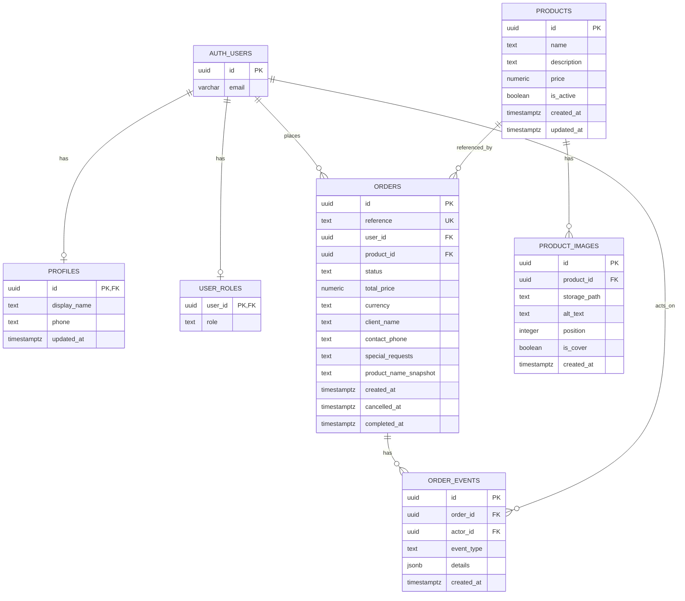

# Art Shop

Art Shop is a multi-page art catalog and order-management application built as a SoftUni “Software Technologies with AI” capstone project.

Visitors can browse active published artworks, search by name, filter by destination/type, price and availability, view product galleries, and open checkout. Registered guests can maintain their profile, place physical-art product orders, review their own order history, and cancel eligible confirmed orders within 24 hours of placement. Administrators can manage products, publication state, catalog images, and customer orders.

An order is created through a database RPC with a server-derived user identity and server-calculated EUR price. Confirmed and completed orders keep a physical product unavailable. Cancelled orders release the product again. Supported order states are `confirmed`, `cancelled`, and `completed`.

The application does not track or claim collected payments. PayPal-related copy is explanatory only unless a real provider integration is added later.

## 2. Architecture

### Front end

- Vanilla JavaScript ES modules
- HTML multi-page application
- Vite for development and static builds
- Bootstrap 5 and Bootstrap Icons
- Responsive shared page shell, navigation, cards, forms, dialogs and toast notifications
- Browser configuration limited to public Supabase URL and publishable key

Vite builds the following routes as separate HTML entry pages:

```text
/                       Home catalog
/products/              Search and filter results
/product/?id=...        Product details
/login/                 Login
/register/              Registration
/order/?productId=...   Authenticated checkout
/order-confirmation/    Persisted order confirmation
/my-orders/             Guest order history
/order-details/?id=...  Guest/admin order details
/account/               Authenticated profile
/admin/                 Admin dashboard
/admin/products/        Product administration
/admin/product-edit/    Product create/edit form
/admin/images/          Product Storage/image management
/admin/orders/          Order administration
```

### Back end and database

- Supabase Auth for identity and sessions
- Supabase PostgreSQL for application data
- Row Level Security (RLS) and database grants for authorization
- PostgreSQL RPC functions for order allocation, cancellation, completion, availability and admin operations
- Supabase Storage for public product images
- SQL migrations stored in `supabase/migrations/`

Privileged operations require server-only credentials. Service-role keys, database passwords and other secrets must never be stored in browser code or `VITE_` variables.

### Main technologies

| Area | Technology |
|---|---|
| Front end | HTML, CSS, vanilla JavaScript ES modules |
| UI | Bootstrap 5, Bootstrap Icons |
| Build tool | Vite |
| Authentication | Supabase Auth |
| Database | Supabase PostgreSQL |
| Authorization | RLS, role table and SQL RPC functions |
| Storage | Supabase Storage |
| Deployment target | Render Static Site |

## 3. Database schema design

The main application tables are:



Key relationships and rules:

- `profiles.id` references `auth.users.id`.
- `user_roles.user_id` references `auth.users.id`; one role row is allowed per user.
- `user_roles.role` is constrained to `guest` or `admin`.
- `products` has non-negative EUR prices and an active/publication flag.
- `product_images.product_id` uses restricted deletion so catalog records retain image integrity.
- `orders.product_id` and `orders.user_id` use restricted deletion, preserving historical order and catalog relationships.
- `order_events.order_id` uses restricted deletion to preserve audit history.
- A partial unique index prevents more than one confirmed or completed order from reserving the same physical product.
- `confirmed`, `cancelled` and `completed` are distinct terminal-safe order states.
- `cancelled_at` and `completed_at` are maintained by database constraints and operations.

The public `product-images` Storage bucket is public for viewing and restricted to administrators for upload, replacement and deletion.

## 4. Local development setup guide

### Requirements

- Node.js and npm
- A Supabase project
- Supabase publishable key
- Server-only service-role key only for seed/admin bootstrap scripts

### Install

```powershell
git clone https://github.com/limanov-softuni/art-shop.git
cd art-shop
npm install
```

### Configure the browser

Create `.env.local` from `.env.example`:

```dotenv
VITE_SUPABASE_URL=https://lskvwfxgpoorcnicttaj.supabase.co
VITE_SUPABASE_PUBLISHABLE_KEY=<publishable-key>
```

Use only a publishable/anonymous browser key. Never place the service-role key in `.env.local`, `VITE_` variables or source code.

### Apply database migrations

Database migrations are committed under `supabase/migrations/`. Apply them to the dedicated Supabase project using the Supabase CLI or MCP migration tooling.

Example migration check:

```powershell
npx supabase db push
```

### Run locally

```powershell
npm run dev
```

Open the Vite URL printed in the terminal.

### Build

```powershell
npm run build
npm run preview
```

The build creates static entry pages for the routes configured in `vite.config.js`.

### Optional server scripts

These scripts require server-only environment variables and must not run in browser code:

```powershell
npm run seed:demo:dry
npm run seed:demo
npm run seed:art-images
npm run bootstrap:first-admin
```

See:

- [Demo seed instructions](docs/demo-seed.md)
- [Art image seed instructions](docs/art-image-seed.md)
- [First-admin bootstrap instructions](docs/admin-bootstrap.md)

The first-admin script requires an explicit existing Auth UUID and server-only credentials. It does not expose a public “become admin” operation.

## 5. Key folders and files

| Path | Purpose |
|---|---|
| `index.html`, `products/`, `product/`, `login/`, `register/`, `order/`, `order-confirmation/`, `my-orders/`, `order-details/`, `account/` | Public and customer-facing Vite HTML entry pages |
| `admin/` | Admin dashboard, products, product editor, image management and order pages |
| `src/pages/` | Page-specific JavaScript modules and Supabase interactions |
| `src/components/` | Shared navigation, page shell, cards, notifications and confirmation dialog components |
| `src/services/` | Supabase browser client and configuration |
| `src/utils/` | Query parameter and Storage URL utilities |
| `src/styles/main.css` | Shared responsive application styling |
| `supabase/migrations/` | PostgreSQL schema, RLS, constraints, Storage and RPC migrations |
| `scripts/seed-demo.mjs` | Rerunnable demo Auth/account/product/order seed |
| `scripts/seed-art-images.mjs` | Public-domain art image and metadata seed |
| `scripts/bootstrap-first-admin.mjs` | Trusted explicit-UUID first-admin bootstrap |
| `docs/access-model.md` | Visitor, guest and admin authorization model |
| `docs/implementation-plan.md` | Project milestones and delivery plan |
| `docs/demo-seed.md` | Demo seed execution instructions |
| `docs/art-image-seed.md` | Real image seed instructions |
| `docs/admin-bootstrap.md` | First-admin bootstrap instructions |
| `.env.example` | Public and server-only environment variable names |
| `vite.config.js` | Multi-page Vite build entry configuration |
| `package.json` | Dependencies and npm scripts |

## Verification and security

- Admin privileges are verified through `user_roles` and database RPC authorization, not a browser role flag.
- RLS protects guest and admin data access.
- Order creation and cancellation use database RPC operations.
- Customer order reads are limited by ownership.
- Catalog and availability queries do not expose order or customer data.
- Product and order foreign keys preserve historical records.
- Service-role credentials remain server-only.
